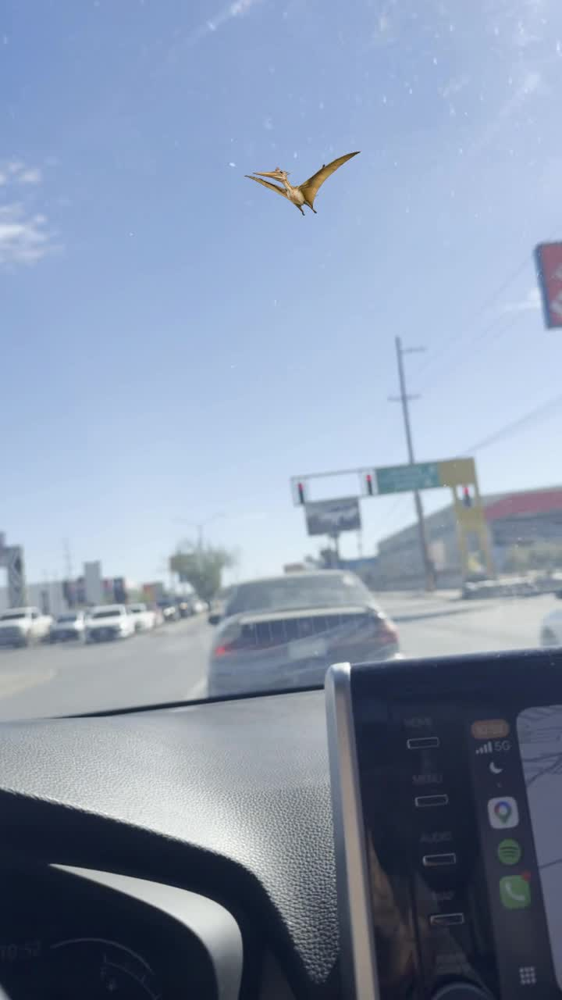

# pterodactilo en el Centro de Cd Juárez

Un pterodáctilo pequeño cruza el cielo del Centro de Ciudad Juárez. El clip está grabado desde el carro, en el tráfico del centro: semáforos, avenida y el tablero al frente. Arriba, el animal planea de derecha a izquierda, chico, como si viniera de muy lejos.

Ciudad Juárez, Chihuahua. Abajo, el centro de siempre. Arriba, algo que no debería estar en ese cielo.

**Ver el video:** [pterodactilo.mp4](pterodactilo.mp4)

## Descripción

Short vertical filmado en el Centro de Cd. Juárez. Un pterodáctilo solitario aparece en el cielo despejado, aletea despacio y se va perdiendo hacia la izquierda, por encima de los cables, los letreros y los coches detenidos. Dura unos ocho segundos. El audio es el del momento: el interior del carro y la calle.

## Hashtags

#Pterodactilo #CiudadJuarez #CdJuarez #CentroDeJuarez #CentroHistorico #Chihuahua #Juarez #Dinosaurio #Pterosaurio #InodeAi #Mexico #Frontera #Shorts #CieloDeJuarez #Prehistoria
